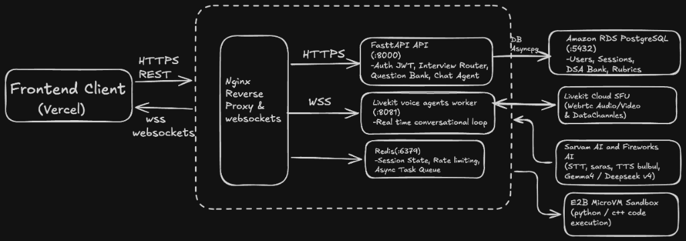

# 🚀 ThinkAloud AI: Unified Backend Monolith

**ThinkAloud AI** is an advanced AI-powered technical interview preparation platform featuring real-time conversational voice interviewers, interactive DSA & System Design coding playgrounds, automated rubric-based candidate evaluations, and career roadmaps.

This repository consolidates the previous 3 microservices (`Scalable_User_Service`, `main_service`, `AI_Interviewer`), RabbitMQ, and Caddy into a single, high-performance, **Modular Monolith** running on FastAPI, PostgreSQL 16, and Redis 7.

---

## 🏗️ Architecture Blueprint




### Key Architectural Decisions:
1. **Single Unified Port (`8000`)**: Eliminates multi-port Caddy reverse proxy routing. All domain services are consolidated under `/api/v1/*`.
2. **Zero RabbitMQ**: Replaced heavyweight RabbitMQ with lightweight, native Redis task queues (`app/tasks/`) for post-interview LLM evaluations and asynchronous code executions.
3. **Data Integrity & Direct Foreign Keys**: Unified database models inherit from a single SQLAlchemy `Base`. Direct foreign keys (`user_id -> users.id`) eliminate distributed replication models (`UserProfileReplica`).
4. **Guaranteed Data Persistence**: PostgreSQL container storage is directly pinned to host directory `/var/lib/thinkaloud/postgres_data:/var/lib/postgresql/data`. Deployments and container updates never wipe data.
5. **Ultra-Lean Resource Footprint**: Total memory consumption is under 2.2 GB RAM, easily deployable on a cost-effective `t3.medium` EC2 instance (< $25/month).

---

## 📁 Repository Structure

```
ThinkAloudAI-Monolith/
├── app/
│   ├── main.py                     # Unified FastAPI instance, lifespan & healthchecks
│   ├── config.py                   # Pydantic BaseSettings with unified env configuration
│   ├── core/                       # Shared platform utilities
│   │   ├── database.py             # Single AsyncEngine, AsyncSessionLocal, Base
│   │   ├── redis.py                # Async Redis connection pool
│   │   ├── security.py             # Password hashing (bcrypt) & JWT tokens (HS256)
│   │   ├── rate_limit.py           # SlowAPI rate limiter with Redis backend
│   │   └── logging.py              # Structured JSON / console logger
│   │
│   ├── modules/                    # Domain-Driven Feature Modules
│   │   ├── auth/                   # Users, Registration, Login, Passwords, Profiles
│   │   │   ├── models.py           # User, UserProfile, UserPreference
│   │   │   ├── schemas.py          # Request & Response Pydantic models
│   │   │   ├── router.py           # /api/v1/auth/* endpoints
│   │   │   └── service.py          # Business logic & Resend email OTPs
│   │   │
│   │   ├── dsa/                    # DSA Question Bank & Code Sandbox Runner
│   │   │   ├── models.py           # DSAQuestion, ProblemTag, CodeSubmission
│   │   │   ├── schemas.py
│   │   │   ├── router.py           # /api/v1/dsa/* endpoints
│   │   │   ├── runner.py           # Subprocess & container sandbox executor
│   │   │   └── service.py
│   │   │
│   │   ├── tracks/                 # System Design, Behavioral, PM, AI/ML, Roadmaps
│   │   │   ├── models.py           # SystemDesignQuestion, BehavioralQuestion, Roadmap
│   │   │   ├── schemas.py
│   │   │   └── router.py           # /api/v1/tracks/* endpoints
│   │   │
│   │   ├── interview/              # Real-Time Mock Interview Sessions
│   │   │   ├── models.py           # InterviewSession, InterviewFeedback
│   │   │   ├── schemas.py
│   │   │   ├── router.py           # /api/v1/interviews/* endpoints
│   │   │   └── service.py          # LiveKit WebRTC room token generator
│   │   │
│   │   └── analytics/              # Unified Platform Stats & Heatmaps
│   │       ├── models.py           # UserStats, DailyActivity, UserSkillScore
│   │       ├── schemas.py
│   │       ├── router.py           # /api/v1/analytics/* endpoints
│   │       └── service.py
│   │
│   ├── voice_agent/                # Real-Time Voice Interviewer (LiveKit + LangGraph)
│   │   ├── worker.py               # LiveKit Agent entry point
│   │   ├── graphs/                 # LangGraph state machine (intro -> approach -> code -> wrap-up)
│   │   ├── prompts.py              # Interviewer personas & prompts
│   │   └── stt_tts.py              # Sarvam / Cartesia / Speechmatics adapters
│   │
│   └── tasks/                      # Background Task Processing (Replacing RabbitMQ)
│       ├── queue.py                # Redis async task dispatcher loop
│       ├── analysis_tasks.py       # Post-interview LLM evaluation judge
│       └── execution_tasks.py      # Non-blocking sandbox execution worker
│
├── alembic/                        # Single Authoritative Database Migration Tree
│   ├── env.py                      # Async SQLAlchemy migration runner
│   └── versions/                   # Migration version scripts
├── data/                           # Canonical question datasets (150+ DSA problems)
├── scripts/
│   └── seed_database.py            # Idempotent DB seeder for questions & tracks
├── Dockerfile                      # Multi-stage lean Python 3.12 image using uv
├── docker-compose.yml              # 3 Services: app, postgres, redis
├── pyproject.toml                  # Single dependency manifest using uv
├── .env.example                    # Complete reference of required environment variables
└── README.md                       # Platform documentation
```

---

## 🚦 Unified API Routing Reference

All endpoints route through the `/api/v1/*` namespace:

| Module | Route Prefix | Key Endpoints | Description |
| :--- | :--- | :--- | :--- |
| **Auth** | `/api/v1/auth` | `POST /register`, `POST /login`, `POST /refresh`, `POST /logout`, `GET /me`, `GET /profile`, `PATCH /profile`, `POST /forgot-password`, `POST /reset-password` | User lifecycle, JWT tokens, profile details |
| **DSA** | `/api/v1/dsa` | `GET /questions`, `GET /questions/{id}`, `POST /questions/{id}/run`, `POST /questions/{id}/submit`, `GET /recommendations` | DSA question bank, dry runs, formal test evaluations |
| **Tracks** | `/api/v1/tracks` | `GET /system-design`, `POST /system-design/{id}/submit`, `GET /behavioral`, `GET /pm`, `GET /aiml`, `GET /roadmaps`, `PATCH /roadmaps/items/{id}/toggle` | Non-DSA interview tracks and learning roadmaps |
| **Interviews**| `/api/v1/interviews`| `GET /types`, `POST /session`, `POST /token`, `GET /{session_id}`, `GET /{session_id}/feedback`, `POST /{session_id}/end` | LiveKit WebRTC room creation, tokens & feedback |
| **Analytics** | `/api/v1/analytics` | `GET /stats`, `GET /activity`, `GET /skills`, `GET /leaderboard` | User activity heatmap, radar skills, global ranking |
| **Health** | `/` | `GET /health/live`, `GET /health/ready` | Process liveness and PostgreSQL/Redis readiness probes |

Interactive Swagger documentation is available at `http://localhost:8000/docs`.

---

## ⚡ Quickstart Guide

### Prerequisites
- Python 3.12+
- [`uv`](https://docs.astral.sh/uv/) (Astral's fast Python package manager)
- Docker & Docker Compose (v2.20+)

### 1. Configure Environment Variables
```bash
cp .env.example .env
```
Inspect `.env` and fill in any required API keys (e.g. `LIVEKIT_URL`, `LIVEKIT_API_KEY`, `LIVEKIT_API_SECRET`, `SARVAM_API_KEY`, `OPENAI_API_KEY`).

### 2. Launch Local Infrastructure (Docker Compose)
Start the PostgreSQL 16 and Redis 7 containers in the background:
```bash
docker compose up -d postgres redis
```

### 3. Run Database Migrations
Run the unified Alembic migration suite to provision all tables:
```bash
uv run alembic upgrade head
```

### 4. Seed Canonical Question Bank
Populate the database with curated DSA questions and interview tracks:
```bash
uv run python scripts/seed_database.py
```

### 5. Start Monolith Development Server
```bash
uv run uvicorn app.main:app --reload --port 8000
```
Visit `http://localhost:8000/docs` to test the API.

---

## 🐳 Full Container Deployment

To run the complete platform (Application, PostgreSQL, and Redis) inside Docker:

```bash
# Ensure host data directory exists with write permissions
sudo mkdir -p /var/lib/thinkaloud/postgres_data

# Build and start all 3 containers
docker compose up -d --build

# Run migrations inside the container
docker compose exec app uv run alembic upgrade head

# Seed question dataset inside the container
docker compose exec app uv run python scripts/seed_database.py
```

Check logs:
```bash
docker compose logs -f app
```

Verify health check:
```bash
curl http://localhost:8000/health/ready
```

---

## 🧪 Testing & Code Quality

Run tests using `pytest`:
```bash
uv run pytest -v
```

Run linter with `ruff`:
```bash
uv run ruff check app/
```

Format code:
```bash
uv run ruff format app/
```

---

## 🔒 Production Host Volume Persistence

To prevent data loss during continuous integration or Docker redeployments, the `docker-compose.yml` mounts PostgreSQL storage directly to host disk:

```yaml
volumes:
  - /var/lib/thinkaloud/postgres_data:/var/lib/postgresql/data
```

This ensures that running `docker compose down` or updating container images **never** deletes production database state.
